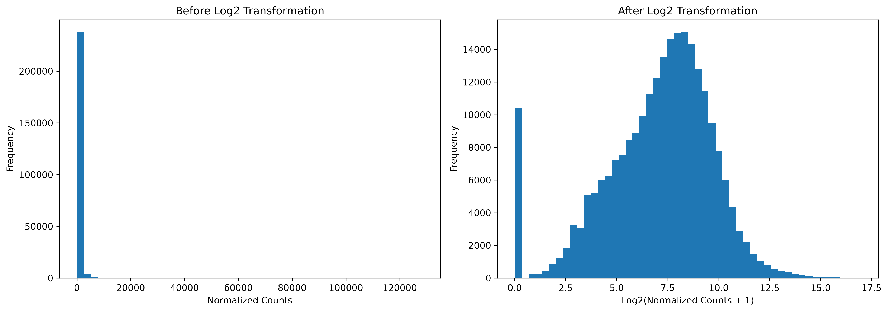
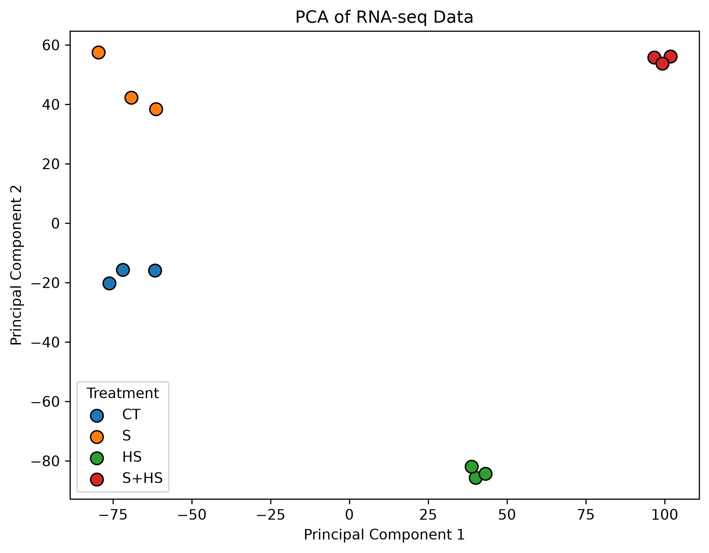
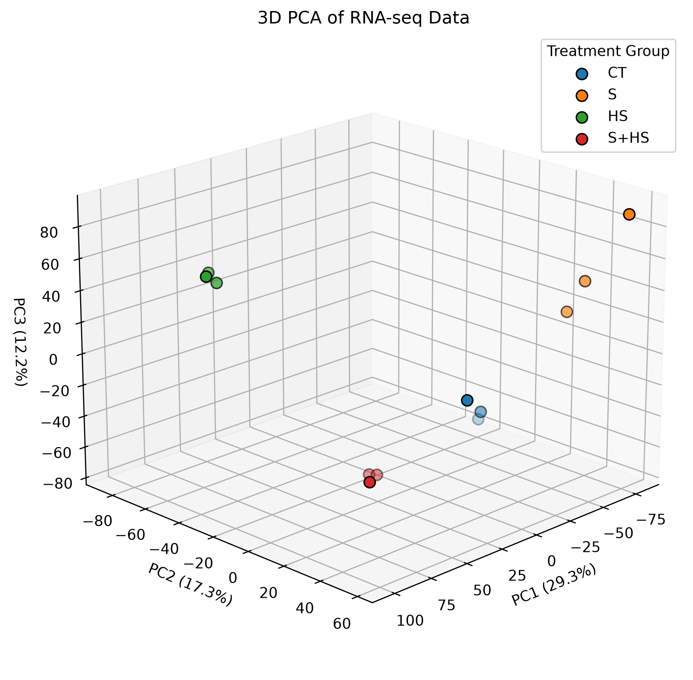
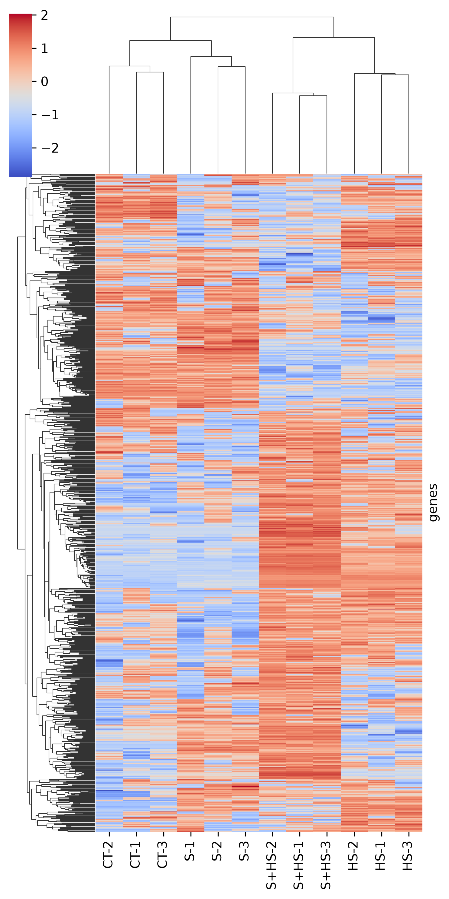
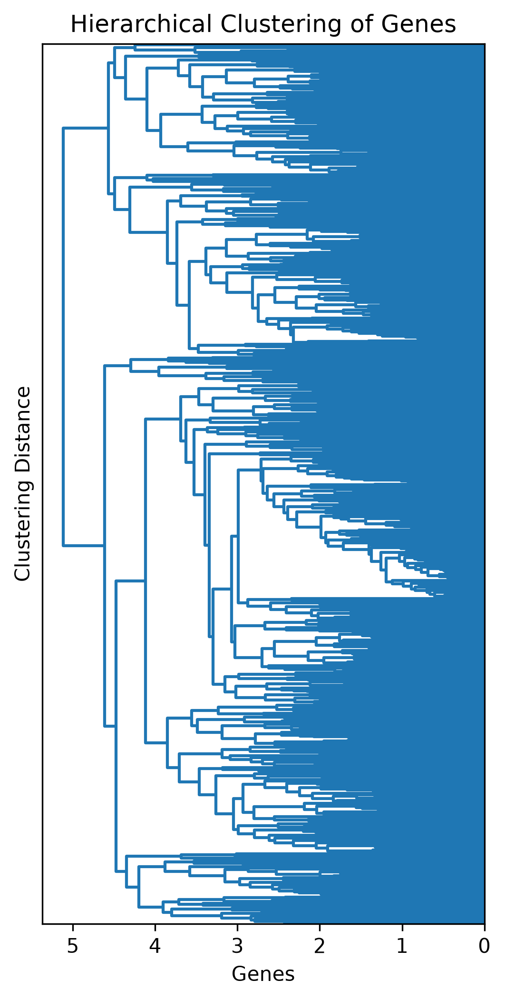
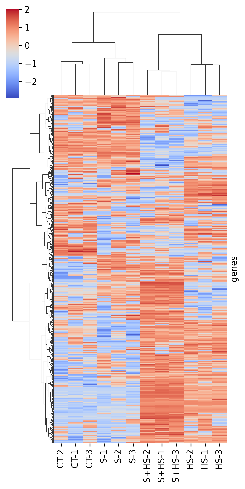
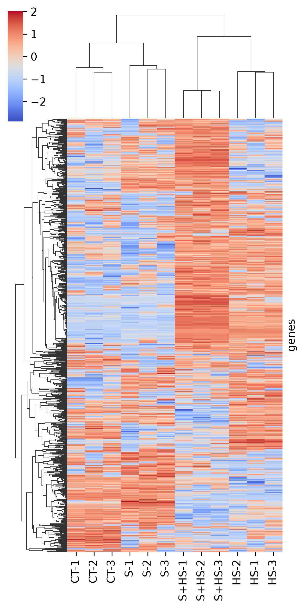
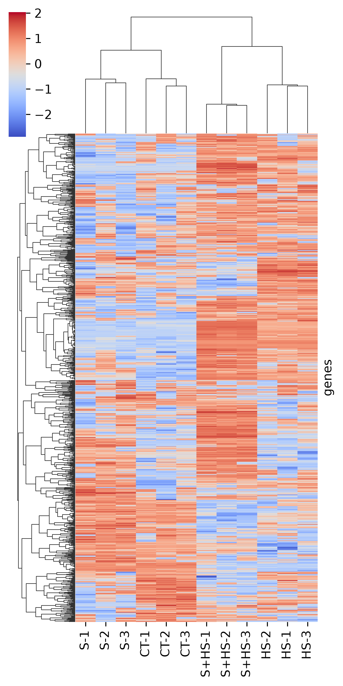

# Response of Tomato to Salinity and Heat Stress

## Project topic

This project studies the effect of salinity and heat stress on tomato plants. The dataset is from the Gene Expression Omnibus:

https://www.ncbi.nlm.nih.gov/geo/query/acc.cgi?acc=GSE245759

This is a bulk RNA seq dataset, which was tested on 24 different samples. It has the expression of 34,000 genes in the 24 samples. The salinity treatment exposed the plants to 150 mM salt, and the heat treatment exposed plants to 37°C temperatures. They had a control group, a salinity group, a heat group, and a salinity + heat group. This dataset also includes samples who were treated with a bacteria, Pseudomonas putida, but for simplicity I will exclude those samples. That leaves 12 of the original 24 samples. 

What I'd like to do is use PCA and hierarchical clustering to see what are the main differences between the treatments, and if salinity or temperature have a stronger effect on gene expression among the tomatoes. I should be able to visually see if salinity has a stronger effect, heat has a stronger effect, or if they both have strong effects. I am interested in this, because I have performed RNAseq experiments in the past on mice where one treatment has a much more powerful effect on the samples than another treatment, to the point you cannot see the effect of the other treatment at all on my PCA plot. 

I believe the dataset is associated with this paper: 

https://academic.oup.com/plphys/article/199/3/kiaf519/8286221

But the paper mentions a different salinity level than the dataset does, so I'm not completely sure. I will use it as a reference to help confirm I trust my results

## Data Cleaning and EDA

The first thing I need to do is clean my dataset, because it includes samples that I won't need. This experiment includes plants that were treated with Pseudomonas putida, which is a bacteria that helps improve crop health and stress resistance. I'm sure that would be interesting to look at, to see how much it helps resist the stressors of heat and salinity, but for now I just want to make sure I can get my models to work, so I wanted to keep the project simple and not include that factor. 

The samples that I want to keep are:

Control: CT-1, CT-2, CT-3

Salinity: S-1, S-2, S-3

Heat Stress: HS-1, HS-2, HS-3

Salinity + Heat Stress: S+HS-1, S+HS-2, S+HS-3

Usually RNAseq data needs to be normalized, to eliminate technical or biological biases. The dataset provided are the mean normalized counts, so I can skip this step. 

The next thing I wanted to do was filter the dataset for genes that have low expression. One common way to do this is to only keep the genes where the count value is greater than 10 in 25% of the samples. This is important, because a gene can have expression levels that are significantly different between groups, but in reality, the gene expression levels are so low, that it doesn't make that much of a difference biologically. This filtering step brought the dataset from 34,000 genes down to 20,000 genes. 

Next, I wanted to look at the distribution of the data, to see if the data needed to be log transformed. I saw that the data was very skewed with a few datapoints that were very large, and the rest were very small, so I decided to log transform the data. 

## Model Building / Model Training

### PCA

The first model I wanted to try with my dataset was a PCA plot. I made a PCA model with two principal components. 

I wanted to see how much of the variance in the data is explained by these two principal components, and the model showed that principal component 1 explained 29% of the variance, and principal component 2 explained 17% of the variance. Combined, these components explain 46% of the variance in the dataset.

I can see that the datapoints separated by the first principal component are separated by heat stress, while the second principal component is separated by salinity. This suggests that heat stress could have a stronger effect on gene expression than salinity, but I want to further confirm this by making a 3D PCA plot, by adding a third principal component. 

The first principal component, which explains 29% of the variance, separates the HS and S+HS samples from the control. The second principal component, which explains 17% of the variance, is what separates the S+HS samples from the control. The third principal component, which explains 12% of the variance, is what separates S and S+HS from the control. So this still suggests that heat stress contributes the strongest to the variation in gene expression, but further testing is needed to conclude which treatment has the strongest effect. 

### Heatmap

The second model I wanted to try with my dataset was hierarchical clustering, using a heatmap of the 1,000 most variable genes. 

Based on this initial heatmap, I can see some clear differences between the groups, but the differences are not as clear as I'd like them to be. This is partially because there seems to be a lot of variability between samples of the same treatment. 

I can see that there are some clusters appearing on the heatmap, but they are hard to view, so I wanted to make a larger version of dendrogram. 

There is a group of genes near the top of the heatmap that has relatively higher expression in the control and salinity group, but relatively lower expression in the salinity + heat stress group, and the heat stress group. If you look at the dendrogram, that specific cluster is only two levels down, meaning that cluster is very different from the other clusters. 

I am also seeing a group of genes in the middle of the heatmap that has relatively lower expression in the control and salinity groups, but relatively higher expression in the salinity + heat stress group and the heat stress group. This group is only four levels down the dendrogram, so it is also very different from the other clusters. 

Together, these clusters account for over one-third of the genes displayed on the heatmap, suggesting that heat stress is associated with substantial changes in gene expression. 

I was curious if changing the clustering methods would change how I view my results, so I tried three additional clustering methods. The default for clustermap is method = average and metric = euclidean. 

method = ward, metric = euclidean

method = average, metric = correlation

method = complete, metric = correlation

The dataset is messy, so it is difficult to tell if any of these heatmaps are much clearer or easier to read than the original heatmap. I find the ward, euclidean dendrogram easiest to read. But on all of the heatmaps, I can clearly see the group of genes that are unique to the plants treated with heat stress or salinity + heat stress. 

## Discussion and Conclusion

For this project, I wanted to see how if heat stress or salinity had a larger effect on gene expression in tomato plants. Based on these preliminary results, I would believe that heat stress has a larger effect than salinity. In the PCA plot, the first two principal components separated the heat stress samples from the control, while the third principal component separated the salinity sample from the control. After looking at the heatmaps, I can see a distinct gene expression pattern in the heat stress samples compared to the salinity treatments. 

This data alone is not enough to make the conclusion that heat stress has a larger effect. I would need to perform further analysis to see what are the genes that are differentially expressed in the heat stress samples compared to the controls, and read about them to see how important these genes are to the function of the plant. 

It would also be interesting to look at this dataset in other plant types, to see which plants respond similarly. It could be that all plants in the same family (the nightshade family) also have a stronger response to heat stress than salinity. But instead, it could be that plants that grow on vines, like cucumbers, have a stronger reponse to heat stress than salinity. 